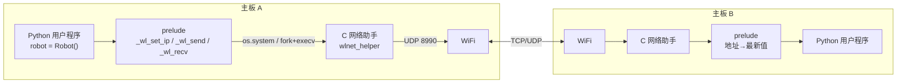
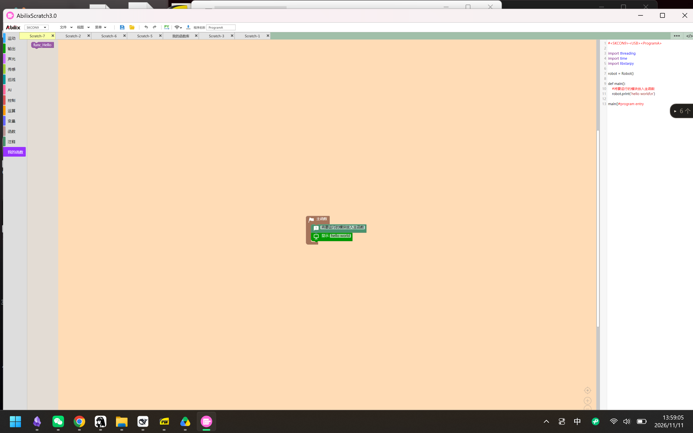
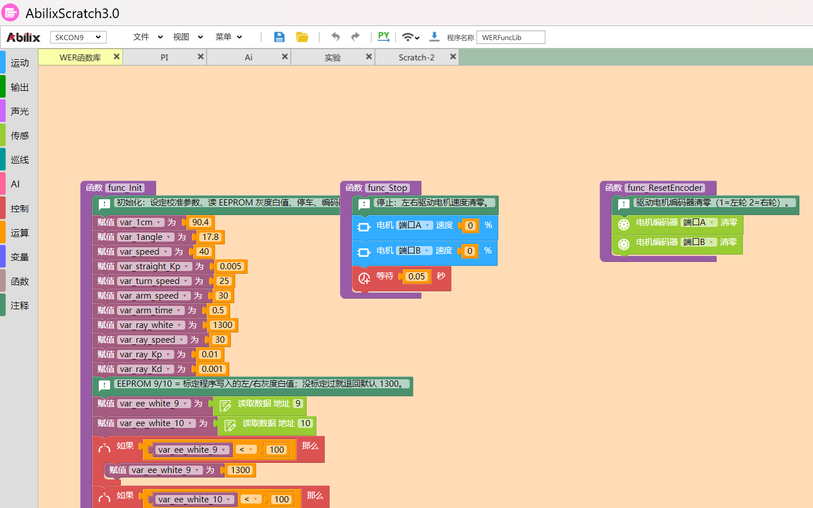

<div align="center">

# 📡 WER 2026 · 双板通讯 & 原生积木

### 两块 SKCON9，不 root、不改系统，用 WiFi TCP 把数据传过去

<p>
  
  
  
  
  
  
</p>

**一句话：** 机器人端 Python 没有 `socket`，所以我们用 8890 下发 C 源码，让机器人自己的 gcc
编译一个 C 网络助手，再用 IDE 原生积木在 Python 里调它。

真机结果：**10/10 ping；4 KB 回显 57.8 ms ≈ 1,134 kbps 双向**。

</div>

---

> [!IMPORTANT]
> **这个仓库不带 85 MB 的 `browser_assets.patched`。**
> 补丁要在你自己的电脑上、用你本机的 `AbilixScratch3.0 1.0.3.4` 生成。
> 安装步骤见 [§6](#6-安装步骤)，详细版见 [`docs/04_安装步骤.md`](docs/04_安装步骤.md)。
>
> 另一个仓库是比赛现场用的 [赛规 & 场地小助手](https://github.com/oficeroes/WER-2026-Map-Assistant)；
> 本仓库只讲**双板通讯 + 自定义积木 + 安装**。

---

## 📚 目录

| 章节 | 内容 |
|---|---|
| [1. 先看结论](#1-先看结论) | 什么可行、什么不可行 |
| [2. 我们做对了什么](#2-我们做对了什么) | 从 8890 到 C 助手到 UDP 8990 |
| [3. 双板通讯原理](#3-双板通讯原理) | 一条消息怎么从 A 到 B |
| [4. 积木块自定义](#4-积木块自定义) | 为什么左侧会多出「双板通讯」 |
| [5. 四个积木](#5-四个积木) | 拖什么、生成什么、怎么用 |
| [6. 安装步骤](#6-安装步骤) | 从零到 IDE 里出现「双板通讯」 |
| [7. 真机结果](#7-真机结果) | 10/10 ping、4 KB 回显 |
| [8. 项目结构](#8-项目结构) | 每个目录放什么 |
| [9. 证据与测试](#9-证据与测试) | 日志/断言/截图 |
| [10. 限制与安全](#10-限制与安全) | 先看，避免踩坑 |
| [11. 版权与致谢](#11-版权与致谢) | 使用边界 |

---

## 1. 先看结论

| 想法 | 结论 | 原因 |
|---|---|---|
| 一条线连两板 1 号口，A 直接读/改 B 的“数据地址” | ❌ **不可行** | “地址 1~128”是本机 STM32 内部 Flash 的槽位，不是内存地址；端口不是存储总线 |
| 用传感器自身发射做两板通讯 | ❌ **固件不支持** | STM32 自主轮询采样；用户读取只读缓存，不能调制发射时序 |
| USB-C 当 ADB | ❌ 不是 ADB | 实际是 **CH340 串口**（COM3，937500 8N1） |
| 机器人上纯 Python `import socket` | ❌ 不可用 | CPython 3.4 没有 `_socket` C 扩展 |
| A `set_do` → B `get_ai` 端口线 bit-bang | ✅ 可行（低速） | 10~几百 bit/s；需自制两针线 |
| 声音/光链路 | ✅ 可行（信标级） | 零/少接线，但只有几~几百 bit/s |
| **C 用户程序 + libc socket** | ✅✅ **首选** | 8890 下发 C → 机器人本机 gcc → JNI → `socket()` |
| 两块板 WiFi TCP | ✅ **真机成功** | 10/10 ping；4 KB 回显 ≈ 1.1 Mbps |

> 详细论证：`双板通讯研究/README_可行性研究主报告.md` §0.0；
> 过程复盘：[`docs/01_我们做了什么.md`](docs/01_我们做了什么.md)。

---

## 2. 我们做对了什么

### 2.1 没有硬啃“端口协议”，而是找到了 C 用户程序

原以为要在 1 号 I/O 口上做文章。查完 STM32 固件后确认：端口只是传感器/执行器接口，
没有“转发到另一块板”的分支。真正的出路是 **8890 文件通道 + 机器人本机 gcc**：

```text
PC ──8890/fileType=20──▶ 机器人
                           │ 解压 .c
                           ▼
                    gcc4.8.2 编译
                           │
                           ▼
                 JNI JCC_Main 加载 .so
                           │
                           ▼
                 C 代码直接 socket()/connect()
```

这条路不需要 root、不需要 ADB、不需要改系统。

### 2.2 用 CH340 确认了“电脑 ↔ 主板”的物理通道

USB-C 实际是 **CH340 串口**，不是 ADB：

```text
发：AA 55 00 08 6F B0 01 00 00 00 01 28
收：AA 55 00 09 6F B0 01 00 00 00 00 01 29
```

官方 PC 软件用 **937500 8N1** 打开它；握手成功说明“电脑 ↔ 主板”的下载/控制通道是通的。
这为后续的 8890 文件传输提供了底气。

### 2.3 把 C 程序 + UDP 8990 封装成“原生积木”

用户不写 C。我们让积木生成的 Python 程序在 `robot = Robot()` 之后自动带一段 **prelude**：

- 把内嵌的 C 源码写到 App 私有目录；
- 用 `os.system` / `fork+execv` 调机器人自带 gcc 编译成 `wlnet_helper`；
- C 助手用 **UDP 8990** 收发（行协议 `S ip addr val` / `R addr val`）；
- Python 侧维护“地址 → 最新值”字典，并把值写入 EEPROM（地址 1~128，同一地址最快 1 秒写一次）。

于是用户只需要拖 4 个积木。

### 2.4 把 4 个块塞进 IDE 左侧

不是“新建项目时塞模板”，而是把块注册进 IDE 自己的 `browser_assets`：

- 只改 **4 个条目**；
- 其余 **6,643 个条目逐字节不变**；
- 不含自定义块的工程，输出与官方 **逐字节一致**（PI 工程 50,618 B，sha256 `30a0bab0…`）。

详见 [§4](#4-积木块自定义) / [`docs/03_积木块自定义.md`](docs/03_积木块自定义.md)。

---

## 3. 双板通讯原理



一条消息的完整路径：

```text
A 的积木「发送 15 到地址 11」
  → _wl_send(11, 15)
  → C 助手 UDP 8990 发出 "S 192.168.1.103 11 15"
  → B 的 C 助手收到
  → B 的 latest[11] = 15
  → B 的积木「接收地址 11 的信息」返回 15
  → B 的 prelude 把 15 写进 EEPROM 地址 11（最多 1 秒一次）
```

为什么不用 Python socket？机器人端实测：

```text
socket=0
No module named '_socket'
math=0  random=0  subprocess=0  serial=0  ctypes=0
py=3.4.5
```

CPython 3.4 只带静态编入 libpython 的模块 + 纯 Python stdlib，没有可动态加载的 C 扩展。
所以必须走 C。

> 详细原理（C 程序下发/编译/JNI、prelude、EEPROM、地址/数值范围）：
> [`docs/02_双板通讯原理.md`](docs/02_双板通讯原理.md)

---

## 4. 积木块自定义

### 4.1 改了哪 4 个条目

`browser_assets` 是自定义 `zfbRes_v1` 归档（6,645 个条目）。补丁只动：

| # | 条目 | 改动 |
|---|---|---|
| 1 | `/Blockly_Code/maingui.html` | 插入 `abilix_userlib.js` 的 `<script>`；在 3 个工具箱 XML 末尾插入「我的函数」/「双板通讯」分类 |
| 2 | `/Blockly_Code/abilix_userlib.js`（新增） | 注册 `Blockly.Blocks['abilixuf_*']` + `Blockly.Python['abilixuf_*']` + prelude |
| 3 | `/Blockly_Code/maingui.js` | `getPythonCode` 两处改成**条件注入**：只有工程里有 `abilixuf_*` 块才注入 prelude |
| 4 | `/Blockly_Code/abilix_userlib.json`（新增） | 清单：版本/构建时间/函数列表/sha256 |

### 4.2 为什么“普通工程不受影响”

条件注入的核心：

```js
((typeof abilixUserLibPython !== "undefined" &&
  workspace && workspace.getAllBlocks &&
  workspace.getAllBlocks().some(function(b){ return (b.type||"").indexOf("abilixuf_")===0; }))
    ? abilixUserLibPython : "") +
Blockly.Python.workspaceToCode(workspace) +
```

- 有 `abilixuf_*` 块 → 注入 `def func_xxx(...)`；
- 没有 → 注入空串，输出与官方**逐字节一致**。

### 4.3 验证

| 场景 | 结果 |
|---|---|
| 真实工程 `PI.srhs`（不含自定义块） | 生成 50,618 B，sha256 `30a0bab0…`，与官方 `PI.py` **逐字节一致** |
| 1 个自定义块 | 32/32 断言通过 |
| 20 个自定义块（11 个带参） | 32/32 断言通过，生成 15,544 B |
| 资源包 | 6,647 条目；4 个改动/新增；6,643 个逐字节不变；+3.9 KB |

<p align="center">
  
  
</p>
<p align="center"><sub>左：IDE 左侧的原生「我的函数」分类 · 右：真实 IDE 里的函数工程。双板通讯用同一套机制再加 4 个块。</sub></p>

> 更细的格式/注入/回滚：`WER_函数库/修改软件说明/01_原理与改动点.md`
> 和 [`docs/03_积木块自定义.md`](docs/03_积木块自定义.md)。

---

## 5. 四个积木

| 积木 | 生成的 Python | 说明 |
|---|---|---|
| 设置对方主板 IP `[192.168.1.103]` | `_wl_set_ip('192.168.1.103')` | 只配置，不发送 |
| 发送 `[值]` 到地址 `[1]` | `_wl_send(1, value)` | 值可以是变量/表达式 |
| 接收地址 `[1]` 的信息 | `_wl_recv(1)` | reporter，可当变量用 |
| 把地址 `[1]` 的信息保存到读写数据 | `_wl_save_ee(1)` | 立刻写 EEPROM |

### 最小示例（两块板）

A 板（IP `192.168.1.102`）：

```text
设置对方主板 IP [192.168.1.103]
永远重复 {
    发送 [计数器] 到地址 [11]
    在屏幕显示 接收地址 [12] 的信息
}
```

B 板（IP `192.168.1.103`）：

```text
设置对方主板 IP [192.168.1.102]
永远重复 {
    发送 [计数器] 到地址 [12]
    在屏幕显示 接收地址 [11] 的信息
}
```

运行后两块屏幕应互相显示对方递增的数值。
掉电保持：B 收到 A 的值后，关掉 B 的程序再运行，B 的“接收地址 11”会先显示上次的值。

> 地址建议用 11/12 这类空地址；1~128 与「读写数据」共用，别覆盖 01=3600、02=400 这类标定值。

---

## 6. 安装步骤

> 详细版/排错：[`docs/04_安装步骤.md`](docs/04_安装步骤.md)
> 源码安装，不需要 85 MB 预编译包；补丁在你本机生成。

### 前置

- Windows 10/11，`AbilixScratch3.0 1.0.3.4`；
- Python 3.8+，命令行能运行 `python`；
- Chrome 或 Edge（生成 prelude）；
- 管理员权限（替换 `Program Files` 下的资源包）；
- 安装时**完全关闭 IDE**。

### 第 1 步：装「我的函数」

双击：

```bat
WER_函数库\工具\原生积木\安装原生积木.cmd
```

- 普通权限窗口先编译（10~30 秒）；
- 然后弹 **UAC** → 点「是」；
- 看到 `[DONE]` 后按任意键关闭；
- 打开 IDE → 左侧应出现紫色「我的函数」。

> 第一次失败最常见原因：UAC 点了「否」，或 IDE 没关。

### 第 2 步：生成「双板通讯」补丁

```bat
python WER_函数库\工具\双板通讯\构建双板通讯扩展.py
```

输出到 `WER_函数库\安装包_双板通讯\`：

- `browser_assets.patched`（约 85 MB，**只在你本机生成，不进 Git**）
- `install_dual.cmd` / `install_dual.ps1`
- `restore_dual.cmd` / `restore_dual.ps1`
- `安装信息.txt`

如果 IDE 装在别处：

```bat
python WER_函数库\工具\双板通讯\构建双板通讯扩展.py --assets "你的\...\Resources\browser_assets"
```

也可以双击 `tools\安装双板通讯积木.cmd`（= 构建 + 调安装脚本，**仍要求第 1 步已完成**）。

### 第 3 步：安装「双板通讯」

双击（或右键以管理员身份运行）：

```bat
WER_函数库\安装包_双板通讯\install_dual.cmd
```

- UAC → 点「是」；
- 脚本检查 IDE 已关闭 → 备份当前资源包 → 替换 → 校验 sha256 → 失败自动回滚。

打开 IDE：左侧「我的函数」旁边应多出 **「双板通讯」**，里面有 4 个块。

### 还原

```bat
WER_函数库\安装包_双板通讯\restore_dual.cmd     :: 回到「我的函数」版
WER_函数库\工具\原生积木\还原原版.cmd            :: 全部回到原版
```

### 常见安装问题

| 现象 | 处理 |
|---|---|
| 双击 `.cmd` 一闪而过 | UAC 点了「否」；重新双击点「是」 |
| 提示「IDE 正在运行」 | 任务管理器结束 `AbilixScratch3.0.exe` |
| 找不到 `browser_assets.patched` | 先做第 2 步构建 |
| 构建报“找不到 `abilixUserLibPython`” | 先做第 1 步安装「我的函数」 |
| 构建报“原版备份不存在” | 第 1 步没成功；重装「我的函数」会生成备份 |
| 安装报“既不是原版也不是已知旧补丁版” | 先用 `还原原版.cmd` 回滚再装 |
| 装完 IDE 打不开 | 运行 `restore_dual.cmd` 回滚，把报错发出来 |

> 完整排错：[`docs/06_排错与限制.md`](docs/06_排错与限制.md)

---

## 7. 真机结果

两块 SKCON9，2026-11-12 12:51：

| 项 | 结果 |
|---|---|
| 网络 | A `192.168.46.109`，B `192.168.47.199`，同一 /23 网段 |
| 下发 | A `W5SERVER.c`（2,334 B / 838 ms）；B `W5CLIENT.c`（2,608 B / 671 ms），均回 `160,3` |
| 连接 | B 的 client 连 A `:8888` 成功 |
| PING | **10/10** 正确 |
| RTT | min 7.75 / avg 34.92 / max 63.61 ms |
| 4,096 B 回显 | 往返 57.8 ms ≈ **1,134 kbps 双向** |
| 需要 root？ | 不需要 |
| 需要改系统？ | 不需要 |

单板回环（W5 自环）实测 4 KB 回显 10.8 ms ≈ **6.1 Mbps** 双向。

证据日志：

- `_分析临时/研究证据/W5_两板/2026-11-12_1251_W5两板_PC监听.log`
- 板内：`/sdcard/Abilix/tmp/w5server.log`、`w5client.log`

> 数字来自开发机 + 用户真机；换路由器/固件/电池可能不同。4 KB 回显是近似吞吐，不是 iperf 精确带宽。

---

## 8. 项目结构

```text
WER-2026-Dual-Board/
├─ README.md                           ← 你在这里
├─ docs/
│  ├─ 01_我们做了什么.md                ← 假设 → 实验 → 真机
│  ├─ 02_双板通讯原理.md                ← C 程序/prelude/EEPROM
│  ├─ 03_积木块自定义.md                ← 4 个条目/条件注入/验证
│  ├─ 04_安装步骤.md                    ← 从零到「双板通讯」分类
│  ├─ 05_真机记录.md                    ← 10/10 ping / 4 KB 回显
│  ├─ 06_排错与限制.md
│  ├─ 07_证据索引.md
│  └─ images/myfunc-flyout.png
├─ 双板通讯研究/                         ← 主报告 + 6 份分报告 + 实验 01–22
│  ├─ README_可行性研究主报告.md
│  ├─ 交接文档_下一步Android与真机验证.md
│  ├─ 实验/实验19_双板通讯积木原型/wl_prelude.py
│  └─ 实验/实验14_W4_C程序下发.js
├─ WER_函数库/                           ← 原生积木源码工具链（不含 85MB 补丁/备份）
│  ├─ 工具/原生积木/原生积木核心.py
│  ├─ 工具/双板通讯/构建双板通讯扩展.py
│  ├─ 工具/底层/patch_browser_assets.py
│  ├─ 我的函数库.srhs / 示例/WER函数库.srhs
│  ├─ 修改软件说明/                      ← 原理/换电脑/回滚/升级
│  └─ 证据/                             ← 32/32 断言、真实 IDE 截图
├─ 逆向资料/下载分析/                     ← AA55/10086/8890/协议规格
├─ _分析临时/研究证据/                    ← W4/W5/W6 日志、EEPROM 实验
├─ tools/
│  ├─ build_dual.py                     ← 从本机 IDE 构建补丁
│  ├─ install_all.py                    ← 构建 + 调安装
│  ├─ 安装双板通讯积木.cmd               ← 双击入口（ASCII+CRLF）
│  ├─ 检查安装.cmd / 还原原版.cmd
│  └─ verify_repo.py                    ← 仓库自检
└─ .gitignore
```

---

## 9. 证据与测试

```bash
# 仓库自检：必需文件 / 坏链接 / 超大文件 / 二进制
python tools/verify_repo.py
```

原生积木证据（都在 `WER_函数库/证据/`）：

- `原生积木验证/`：32/32 断言、PI 黄金样本、1/20 函数工程；
- `真实IDE验证/`：真实 IDE 截图/记录；
- `框架端到端验证/`：物理屏幕截图；
- `离线安装包/`：安装/还原日志。

双板真机证据：

- `双板通讯研究/README_可行性研究主报告.md` §0.0 A–H；
- `_分析临时/研究证据/W5_两板/`、`W4_C程序/`、`实验20_读写数据持久化/`；
- [`docs/05_真机记录.md`](docs/05_真机记录.md)。

---

## 10. 限制与安全

> [!WARNING]
> 这几条是使用前提，不是“以后再说”：

1. **对方必须正在运行一个含任意「双板通讯」积木的程序**；对方一个程序都没跑，就收不到。
2. **机器人同一时刻只能运行一个用户程序**；先跑 server 再跑 client 会把 server 顶掉。
3. **程序需要手动在机器人屏幕上启动**；没找到远程自动起跑入口。
4. **两块板必须在同一 2.4G WiFi**，IP 互指。
5. **地址 1~128 与「读写数据」共用**；测试用 11/12 等空地址。
6. **数值是整数 −99999~99999**；文本/浮点自己编码成整数。
7. **没有后台常驻/加密/鉴权**；只适合自己队伍的设备。
8. **8890/10086/7777/9999 无鉴权**：不要干扰、篡改、攻击其他队伍的设备。
9. **不要 root / 改 Android / testkey / ADB**：风险高；本项目没有执行，也不建议在比赛设备上尝试。

---

## 11. 版权与致谢

- 本仓库中**我们自己写的**文档、代码、实验、日志：可自由用于学习、教学和比赛准备；转载请注明出处。
- 官方软件、固件、APK、手册、赛规：版权归能力风暴（Abilix）/ 赛事主办方所有；仓库**不包含**从官方安装包提取的源码/反编译/85 MB 补丁。
- 逆向资料仅用于本机学习与比赛准备；请勿传播从官方软件安装包内提取的资源。
- 感谢用户提供两块 SKCON9、真机测试环境、几十轮反馈；感谢一起做协议/固件/文档/验证的协作 AI。

---

<div align="center">

**“不是把端口变成网线，而是让机器人自己编译一个 C 网络程序。”**

<sub>WER 2026 · 伙伴机器人 · 双板通讯 & 原生积木</sub>

</div>
