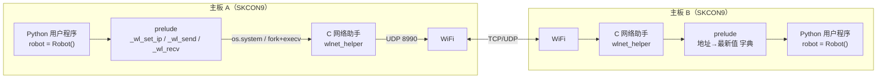

# 02 · 双板通讯原理：一块板怎么把数据发给另一块

> 这一页讲“它为什么能工作”。过程/实验见 [`01_我们做了什么.md`](01_我们做了什么.md)；安装见 [`04_安装步骤.md`](04_安装步骤.md)。

## 1. 总览



关键点：

- **Python 侧不直接联网**（CPython 3.4 没有 `_socket`）。
- Python 侧只负责：设置对方 IP、把值交给 C 助手、从 C 助手取“地址→最新值”、把值写进 EEPROM。
- 真正的 WiFi 收发在 **C 助手**里，用 libc `socket()`。
- 积木生成的 Python 程序会自动带 prelude；用户拖积木即可，不需要手写 C。

## 2. 为什么不用 Python socket？

机器人端 Python 实测：

```text
socket=0
No module named '_socket'
math=0  random=0  subprocess=0  serial=0  ctypes=0
py=3.4.5
```

CPython 3.4 只带“静态编进 libpython 的模块 + 纯 Python stdlib”，没有可动态加载的 C 扩展。
所以 `import socket` 直接失败。任何“在机器人上跑 Python 开 TCP/UDP”的方案，在现有固件下都不成立。

## 3. 为什么 C 程序能跑？

8890 文件通道支持 `fileType=20`（C 用户程序）：

1. PC 把 `.c` 源码打成 zip，经 `8890 + fileType=20` 发给机器人；
2. 机器人侧 `handleProgramZip` 解压；
3. 机器人本机 **gcc4.8.2** 编译：
   `arm-linux-androideabi-gcc *.c -pie -fPIC -L. -lm -lRobot -shared`
4. 产物复制为 `filesDir/libuser.so`；
5. `libRobot.so` 的 JNI `JCC_Main` 在 Controller 进程内 `dlopen` 执行；
6. C 代码可以直接调用 libc：`socket / connect / send / recv / open / system`。

这条路**不需要 root、不需要 ADB、不需要改系统**。W4 探针在真机上连到 PC，证明通道成立；W5 两板各跑一个 C 程序，端到端跑通。

## 4. 运行时 prelude 做了什么

积木生成的程序在 `robot = Robot()` 之后会多出一段 prelude（只有工程里用了 `abilixuf_*` 积木时才会注入）：

| 函数 | 作用 |
|---|---|
| `_wl_set_ip(ip)` | 设置“对方主板 IP”（只做配置） |
| `_wl_send(addr, value)` | 把整数 `value` 发到对方地址 `addr`（1~128） |
| `_wl_recv(addr)` | 读“对方地址 `addr` 的最新值”；没收到时回读 EEPROM 旧值，从没写过返回 0 |
| `_wl_save_ee(addr)` | 立刻把当前值写入本机「读写数据」对应地址（不等自动节流） |

prelude 的主要工作：

1. 把内嵌的 C 源码写到 App 私有目录；
2. 用 `os.system` 或 `fork+execv` 调机器人自带 gcc 编译成 `wlnet_helper`（`/data/data/com.abilix.controller/files/`，因为 `/sdcard` 是 noexec）；
3. 启动 C 助手，UDP 8990 收发行协议；
4. Python 侧维护 `addr -> latest value` 字典；
5. 收到新值时写入 EEPROM（同一地址最快 1 秒一次、只在变化时写，保护擦写寿命）。

> 为什么是 UDP 8990？这是我们自己约定的端口/行协议（`S ip addr val` / `R addr val`），不是官方协议；双方程序都由同一套 prelude 生成，所以能互通。

## 5. 地址与 EEPROM

- “地址 1~128”**就是主板界面里的「读写数据」01~128**，同一套槽位。
- 掉电不丢，但在**本板** STM32 内部 Flash（约 `0x0801F000`，128×32B）。
- 通讯地址与「读写数据」共用：如果某些槽已有旧数据（例如 01=3600、02=400），测试建议用 11、12 这类空地址。
- 数值范围：整数 **−99999 ~ 99999**。
- 自动节流：同一地址最快 1 秒写一次，且只在数值变化时写；要立刻保存用第 4 个积木。
- 程序重启后、还没收到新数据时，“接收”积木回读 EEPROM 旧值；从没写过的地址返回 0。

## 6. 一条消息的完整路径

```
A 的积木「发送 15 到地址 11」
  → Python prelude: _wl_send(11, 15)
  → C 助手: UDP 8990 发出 "S 192.168.1.103 11 15"
  → B 的 C 助手收到
  → B 的 Python prelude: latest[11] = 15
  → B 的积木「接收地址 11 的信息」返回 15
  → B 的 prelude 把 15 写进 EEPROM 地址 11（最多 1 秒一次）
```

反向同理：B 设置 A 的 IP，发到地址 12，A 接收。

## 7. 四个原生积木

| 积木 | 生成的 Python | 说明 |
|---|---|---|
| 设置对方主板 IP `[192.168.1.103]` | `_wl_set_ip('192.168.1.103')` | 只配置，不发送 |
| 发送 `[值]` 到地址 `[1]` | `_wl_send(1, value)` | 值可以是变量/表达式 |
| 接收地址 `[1]` 的信息 | `_wl_recv(1)` | reporter，可当变量用 |
| 把地址 `[1]` 的信息保存到读写数据 | `_wl_save_ee(1)` | 立刻写 EEPROM |

### 最小示例（两块板）

A 板（IP `192.168.1.102`）：

```text
设置对方主板 IP [192.168.1.103]
永远重复 {
    发送 [计数器] 到地址 [11]
    在屏幕显示 接收地址 [12] 的信息
}
```

B 板（IP `192.168.1.103`）：

```text
设置对方主板 IP [192.168.1.102]
永远重复 {
    发送 [计数器] 到地址 [12]
    在屏幕显示 接收地址 [11] 的信息
}
```

运行后两块屏幕应互相显示对方递增的数值。

## 8. 限制（先看，避免踩坑）

1. **对方必须正在运行一个含任意「双板通讯」积木的程序**；对方一个程序都没跑，就收不到（机器人没有代码在跑）。
2. **机器人同一时刻只能运行一个用户程序**；先跑 server 再跑 client 会把 server 顶掉。
3. **程序需要手动在机器人屏幕上启动**；没找到远程自动起跑的入口。
4. **两块板必须在同一 WiFi（2.4G）**；“设置对方主板 IP”要互指。
5. **没有后台常驻服务**：想让“没开程序也能收”，需要改 Android 常驻服务，属高风险改造。
6. **地址 1~128 与「读写数据」共用**，测试用空地址，别覆盖已有标定数据。
7. **数值是整数 −99999~99999**；文本/浮点需要自己编码成整数（例如 ×100 传）。

## 9. 安全边界

- 8890/10086/7777/9999 **无鉴权**，只在**自己队伍的设备**上做实验。
- 不要用这些通道干扰、篡改、攻击其他队伍的设备；不要用于比赛规则不允许的行为。
- 改 Android / testkey / ADB 的路径风险高，本项目**没有执行**，也不建议在比赛设备上尝试。

---

*过程：[`01_我们做了什么.md`](01_我们做了什么.md) · 安装：[`04_安装步骤.md`](04_安装步骤.md) · 真机记录：[`05_真机记录.md`](05_真机记录.md)*
